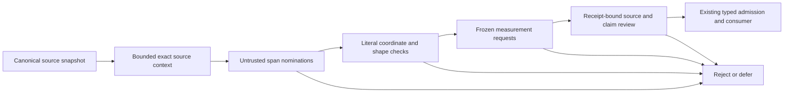

# Replacement evidence-supply architecture — proposal only

**Recommendation: test bounded context retrieval followed by untrusted semantic span extraction, then unchanged measurement and admission.** Do not build another structural role/act composer. The smallest next experiment should first isolate whether extraction can supply valid exact evidence when adequate context is available; it should not mix that question with a new retriever's recall.

Brian accepted V1.1 development **FAIL**, retained **G1 HOLD**, and closed further development/execution of that collector architecture on 2026-10-18. No V1.2, K/window/quota adjustment, embedding-model substitution or unseen confirmation is proposed. `decision-v1.json` records that decision separately without changing historical artifacts.

**Current authorization is proposal/design only.** The only software added is a read-only review-packet verifier and CLI adapter. No replacement retriever, context tiler, extractor, provider client, packet executor or new admission adapter has been implemented. No contexts, new references or runnable request queue have been materialized; no model is selected, downloaded, loaded or executed; no provider requests or fresh-source selection occurred.

## What the failure establishes

The sealed V1.1 audit reports G2 18/65 versus V3 30/65, current G3 58/84 versus 62/84, and reported G3 12/25 versus 20/25. Its 47 G2 misses separate into 33 absent complete-role descriptors, five collapsed/overlapping-role geometries and nine top-K losses. Source 520's 111 repaired navigation units were reconnected into a 5,454-character mixed target and a 32,356-character deferred component. Only one of nine quota-displaced targets was an otherwise-valid whole P1 act.

Those findings argue against another handcrafted semantic-boundary layer or a larger quota. They do not establish that frozen source coordinates, P1, embeddings or the accepted semantic/admission policies are inadequate. The proposed change moves **semantic target nomination** out of structural composition, while preserving literal source navigation and conservative verification.

## Compare the architectures

| Architecture | Where final role/act boundaries originate | Benefits | Principal risk | Decision |
|---|---|---|---|---|
| Closed V1.1 candidate-first | Clause rules, dependency closure and retained core quotas precede semantic measurement | Cheap, inspectable source-only nomination; exact spans | Missing/overlapping roles, overclosure, clipped dependencies and mixed speech; rank changes cannot repair absent roles | Historical comparator only; no further execution/tuning |
| Bounded context + generative extraction | An untrusted extractor proposes exact source spans inside supplied context; code copies source, never generated prose | Can propose unseen boundaries, nonlocal directed roles and semantically necessary completions without enumerating span pairs | Hallucinated coordinates, omitted qualifiers, invented voice/adoption, omissions and output saturation; requires a separate model and review | **Recommended discriminating probe** |
| Bounded context + Jev semantic cursor | New discovery questions select source-position IDs, potentially in several passes | Can retain the existing decision-model stack; coordinate choices remain literal | Large boundary option spaces, multi-step error, multiple-event enumeration and pairing cost; not the closed measurement question set | Plausible alternative, not implemented or benchmarked now |

Jev returns typed decisions over configured answer spaces rather than arbitrary generated text. Its value-selection cookbook also makes candidate coverage a prerequisite. Thus “let Jev extract arbitrary spans” is not a drop-in capability: it would need position-selection discovery questions or an upstream proposer. These are interface constraints, not a new accuracy judgment. [TypeSafe System One](https://docs.typesafe.ai/concepts/system-one), [value extraction](https://docs.typesafe.ai/cookbooks/pre_parsed_value_extraction_cookbook).

TypeSafe's line-search example selects labeled source lines and separately checks answer presence. This supports investigating a semantic cursor, but does not prove complete P1 boundaries or G2 pairing in sermons. Expanding every start/end combination would recreate a combinatorial candidate problem; a cursor needs its own versioned design and budget. [Line-by-line search](https://docs.typesafe.ai/cookbooks/semantic_find).

The separate-extractor approach is consistent with TypeSafe's extraction/verification cascade pattern. That cookbook also demonstrates that a schema-conforming record can be semantically wrong. Its model choices, thresholds and reported results are examples, not PTE authorizations or evidence of sermon performance. [Extraction cascade](https://docs.typesafe.ai/cookbooks/sde_cascade).

## Proposed flow and authority



Only the final admission/export boundary may create usable local evidence. The first experiment stops before the measurement stage. No nomination is a `Measurement`, `LocalEvidence`, accepted witness or pastor-creditable observation.

### 1. Retrieve context, not semantic targets

Retain Source-unit Repair V1 for navigation and index locators. Navigation units and embedding ranks carry no act, role, source or recipient meaning. Do not run V1.1 role construction or dependency closure to form the new contexts.

For an eventual first source-wide design, prefer a **coverage-first bounded scan** as a transparent baseline: contiguous windows of at most 6,000 canonical characters with a proposed 3,000-character stride and a final tail window. Windows are source neighborhoods, not claims of event completeness. No parent-sentence closure, omitted internal turns, synthetic montage, summarization or semantic target construction is allowed.

This baseline is intentionally separate from top-K retrieval. A future lexical/embedding index could prioritize neighborhoods, but a sparse shortlist must report the context coverage it loses; it cannot inherit complete-scan availability. Keep the current encoder only as an optional recall component, without tuning, loading or model comparison now. Coverage-first scanning can still be prohibitively costly on a corpus, so neither it nor selective retrieval is declared operationally ready.

Half-overlap guarantees only literal containment of intervals no longer than the stride, subject to exact edge handling. Some evidence spans between 3,000 and 6,000 characters can straddle windows; reporting identity may be farther away. Longer required context remains a disclosed miss/defer, even when an atomic act itself is short. No claim of semantic or provenance completeness follows from full character coverage.

The eventual selector may return a different contiguous window if separately authorized, but cannot concatenate far-away snippets to evade the existing envelope contract. The first probe has **zero automatic context expansions**. Adequacy is independently reviewed before execution; absent context must not be reconstructed from model memory or silently borrowed from the full-source audit.

### 2. Extract nominations within the supplied context

Use **one generative extractor**, one prompt/schema and one response per context in the proposed probe. The model may propose up to four items and must signal overflow or uncertainty. The exact provider/model snapshot is deliberately not selected in this design-only phase; no model-shopping experiment is proposed. Codex would lock one eligible snapshot, token accounting, API parameters and price during separately authorized preparation and return the concrete execution packet to Brian.

The extractor receives the canonical source context, coordinate convention and general G2-or-G3 task instructions. Capability must match that task family; G3 requests do not reveal whether the oracle expects current or reported speech. It does **not** receive the diagnostic case label, focal reference, expected target, V1/V3 result, source-review oracle or desired positive count. Task text is distinguished from transcript text, including instructions spoken inside the sermon.

For G2 it may nominate a directed Bible/text anchor and explanation, each an exact contiguous source span. A citation, thematic resemblance or neighboring quote is not an established explanatory edge. For G3 it may nominate a P1 utterance, including necessary qualifiers/completions, separately from source/recipient context. The first probe proposes atomic acts only, with **null circumstance**; it does not reopen circumstance relations or pastor-level credit.

Provenance, recipient, adoption, dependency and completeness outputs are **untrusted hypotheses** with literal supporting spans or `unknown`. They are not verified source facts. Required conditions cannot be moved to the envelope merely to make an utterance shorter. Independent adjacent acts remain distinct; reported, modeled, historical, current and God-directed speech cannot be silently combined. If the existing exact-contiguous contract cannot represent an event, the result is a deferral, not a new object definition.

See `interface-design-v1.json` for the proposed transport fields and authority separation. This is a design artifact, not a replacement semantic contract or executable schema integration.

### 3. Verify literal structure without pretending it proves meaning

Provider-independent code can check source identity, hashes, local/global offset arithmetic, verbatim substrings, bounds, nonoverlapping G2 endpoints, direction, contiguous frames/envelopes, output limits, immutable receipts and exact duplicate coordinates. It can reject malformed or foreign records without asking the provider whether its own answer is valid.

Coordinates remain canonical Python Unicode code-point offsets with exclusive ends. UTF-8 snapshot hashes are distinct from character indexing. No Unicode/newline normalization, punctuation repair, fuzzy quote repair or “first matching occurrence” fallback is permitted. Repeated words at different positions stay distinct occurrences. A repeated geometry can be linked without becoming a second unique item or evidence of recurrence.

Code **cannot** independently prove that a literal quotation is an atomic act, that an omitted qualifier is irrelevant, or that a reported voice has become the preacher's adopted position. Those remain semantic/source-review obligations. Hashes bind a review decision to exact evidence; they do not attest semantic truth. A schema-valid extraction has no more semantic authority than a schema-valid wrong Jev answer.

### 4. Preserve frozen measurement and admission

The proposed handoff copies only exact candidate coordinates/text and the full supplied context into existing materialization/request shapes. Extractor labels, rationales and self-confidence must not be injected as asserted facts in frozen Jev state. Preserve G2 direction, G3 phase isolation, null-circumstance handling, question meanings, options, .80 selected-option gate and immutable raw answers. G1 is outside the initial probe and remains HOLD; its closed semantics are not revisited.

Keep provenance evidence within the actual supplied envelope. A reviewer seeing the full sermon may discover missing context but cannot use that knowledge to certify an item whose request did not include the necessary evidence. Nonbiblical attribution, narration, nested speech and incompatible recipient/adoption must still quarantine rather than merely gain diagnostic metadata.

There is a concrete integration gap: `evidence_supply_boundary_v4.validate_packet` accepts the frozen **24-case/37-request V4 panel**, and A1 policy/source/claim authorities bind exact packets and measurements. Those existing authorizations do **not** apply to new extractions. The reusable materializer, question semantics and admission invariants can be retained, but a future separately versioned receipt transport/adapter and newly accepted source/claim authority would be needed. No generic adapter or automatic witness is implemented or assumed valid here. If an adapter requires changing a closed contract, stop for a separate decision rather than silently extending it.

The human/source-controlled witness remains a safety oracle for a bounded experiment, not a proposed permanent human-review-everything collection architecture. Automation of provenance/sufficiency, review throughput and deferral economics remain independent unresolved gates.

## Retained and retired components

| Component | Treatment |
|---|---|
| Canonical source snapshots, hashes, exact offsets and frozen bounded units | Retain as navigation/evidence substrate |
| P1 and current/reported namespace distinction | Retain without rewriting historical checks |
| MiniLM ranking adapter and exact lock | Historical artifact; optional future context prioritizer only, no execution/tuning now |
| V1.1 clause/core dependency lattice, G2 primary-role construction and semantic target quotas | Retire from further development; preserve bytes/results for inspection |
| Existing geometry/materialization and immutable receipt/seal discipline | Reuse semantics where compatible; prospective adapter still requires proof/authorization |
| Frozen G1/G2/G3 questions, .80 gate, G3 phase isolation and typed consumer boundary | Preserve; no new extractor output may bypass them |
| V4/A1 review authority and accepted panel result | Preserve as bounded historical authority; do not reuse witness identities for new observations |

The new proposed output cap is an independent **probe resource limit**, not a patch to the retired 8N/2N collector. Overflow is visible and never silently earns full recall. It provides no justification to alter old quotas or results.

## Expected burden and retrieval requirements

Three retired sources contain 37,811, 27,291 and 54,202 main-source characters. Arithmetic for 6,000-character windows at a 3,000-character stride gives **12 + 9 + 18 = 39** neighborhoods, at most **234,000 source-character exposures**, before task/schema overhead. These are design calculations on existing metadata, not generated windows, an executed source scan or a cost result. Such a scan could replace thousands of candidate requests with fewer larger requests, but output density, missed cross-window dependencies and review burden could erase the advantage.

Token counts do not equal characters divided by a universal constant. For ordinary English, roughly 2,000–4,000 input tokens per proposed context including modest instructions is a planning estimate only; exact extraction model/tokenizer and complete serialized state must be sealed before execution. Unicode, ID annotations and task/schema overhead can exceed that estimate. The proposed hard input cap is **16,384 tokens/request**, with no silent truncation. Request cost includes both input and all chargeable output/reasoning tokens.

The full pipeline's opportunity supply is limited by successive stages: adequate context availability, complete source-compatible nomination, frozen measurement eligibility and admission. These stages are conditional, not statistically independent. High extraction performance given an oracle-assisted context does not establish natural retrieval recall. A retriever must later show coverage of **both G2 roles and their required source evidence**, or **the full P1 utterance plus required provenance**, within compatible bounded contexts. Literal role coverage, required-evidence coverage and explicit source review remain separate measures.

Duplicates across windows, unmatched nominations and negative-control contacts are review-work counts, not unique usable observations, false positives or recurrence. A 6,000-character window may contain more than four eligible events; saturation must remain in the denominator/deferral ledger. No corpus cost or collection readiness is inferred.

## Smallest discriminating experiment

**Question:** with adequate source context deliberately supplied, can semantic extraction nominate supported exact targets that structural composition could not reliably form?

Design slate: **24 contexts**, all from existing retired evidence; no fresh sources. Twelve adequate positive contexts cover four G2 cases, four current-speaker G3 cases and four reported-local G3 cases. Six clipped counterparts (two per route) place required explanation/qualification/reporting evidence outside the supplied contiguous span. Six controls cover nonbiblical attribution, citation without explanation, narration, God-directed prayer, counterfactual/model speech and an unresolved neighboring speaker. `experiment-v1.json` fixes the design locators and purposes; it contains no materialized source contexts or new gold targets.

Codex would prepare everything after separate authorization. Adequate-context and clipped/control statuses must be checked independently against full source, with prospective P1 annotations sealed before outputs. Existing reference IDs locate development evidence only; their frozen target definitions/counts are unchanged. P1 annotations are a new explicitly prospective panel oracle, not corrected historical expectations and not accepted admission witnesses. If a selected slot cannot be established within the existing contiguous 6,000-character contract, preparation returns HOLD and discloses the slot; there is no post-output substitution.

Model-visible IDs are neutral. Complete/clipped pairs share the same unmodified source; clipping changes only the supplied contiguous bounds, never deletes internal words or rewrites source. Include context edge/continuation availability flags. A clipped context can still contain other valid evidence, and a counterfactual control can contain a legitimate reported act: neither is automatically an all-negative document. Score the designated event/scope and audit every additional output. Source-unidentifiable provenance remains unknown; the model is not expected to reconstruct absent reporting context.

**One model, one prompt/schema, at most 24 extraction requests, zero retries or automatic expansions, at most four nominations/context (96 total).** Proposed hard ceilings are 393,216 input tokens and 49,152 total output/reasoning tokens. Proposed maximum paid exposure is **$5.00**, a budget cap rather than a price quote or authorization. Actual locked rates and token caps must satisfy `(393216 * input_rate + 49152 * output_rate) / 1000000 + other chargeable fees <= 5.00`; otherwise reduce/re-propose before execution, never substitute models or raise the cap automatically. The exact model, price, request fingerprint and executable command are not yet available. No current paid execution is authorized.

**Primary falsification criterion:** at least **10/12** adequate contexts must yield a whole source-supported exact nomination for the designated opportunity, with at least **3/4 in each route**. No manual target surgery, re-prompt, source repair, later widening or favorable alternative denominator can rescue a miss. All raw outputs, omitted designated opportunities, duplicates, saturation and control findings must be source-audited. Record active preparation/review minutes within a proposed 480-minute cap; exhausting it before complete review produces HOLD, not a favorable sampled result. This cap is not an estimate of operational throughput. Coordinate-invalid or unrepresentable items cannot count as successful nominations. Incomplete source review or unresolved eligibility produces HOLD.

Separate raw extraction findings from authority enforcement. Unsafe raw nominations or unsupported completeness/provenance claims remain errors even if source review later quarantines them. They must be reported by failure class and quantity, alongside adequate-context success and clipped/control behavior, before recommending further work. This first probe cannot establish containment PASS merely because it has no export path, and it cannot establish raw semantic perfection from a small inspected slate. Supported positives prevent success by returning nothing.

The candidate-first comparison uses **saved immutable V3/V1/V1.1 outputs and audited failure mechanisms**, not another collector run. A prospective P1 review may describe whether an existing whole natural target is adequate for the same diagnostic opportunity, but this is not a historical rescore. Since the extraction arm deliberately receives reviewed adequate contexts, its recovery cannot be claimed as end-to-end improvement over natural retrieval. A matched-context/held-out retrieval comparison is a later independent experiment.

This probe makes **no Jev calls** and executes no admission or consumer path. If nomination feasibility passes, the next proposal would be a tiny adapter/measurement/admission test, not a retriever redesign or collection activation. With all 96 proposed nominations at their caps, a later frozen measurement pass could require up to **160 phase requests** (32 G2 items at one request plus 64 G3 items at two); none is bundled into the 24-request authorization proposal. Actual supported nominations and exact costs would need a separate packet.

## Decision requested next

Recommend authorizing **only small probe implementation and provider-free preparation** of these 24 contexts, source oracle, single-model lock, strict coordinate validator and sealed execution packet. Do not authorize a production replacement collector, automated provenance resolver, semantic/admission changes or provider execution at that step. Brian receives a concrete fingerprint-bound command after preparation and approves the separate paid decision; he is not assigned model research, case selection or annotation work.

If adequate context still yields poor exact targets, report the failed hypothesis instead of growing structural heuristics around the extractor. If it works, it establishes a reason to investigate context recall and unchanged-pipeline handoff, not permission to use the observations in a pastor profile.

G1 HOLD, automatic provenance/sufficiency, opportunity denominators, review throughput/deferrals, recurrence/rates, corpus economics, broader collection/production, the 790-item V2 audit and pastor projection/comparison/scoring remain held.

Read-only packet check available now:

```sh
pte analysis collector-retrieval-design --context-extraction-proposal --check-only
```

The CLI extension preserves the frozen original design callback and all experiment inputs. It verifies documents and pins only; there is no execute or materialize mode. `packet-v1.json` binds the Markdown, design JSON, experiment slate, interface design and accepted closure decision. No current provider command exists.

## Verification of this proposal packet

Six focused proposal/authority tests pass, alongside 42 existing retrieval/design/audit tests and 23 CLI tests: **71 tests total**. Tests verify design-only holds, closure identity, exact prospective budget/route controls, rejection of a materialized or executable probe, hash mismatches, encoder-free checking and delegation to the original frozen design callback. These tests establish document/CLI integrity only; no context retrieval, extraction quality or semantic/admission performance has been tested. The original V1.1 source-audit fingerprint still verifies unchanged.
